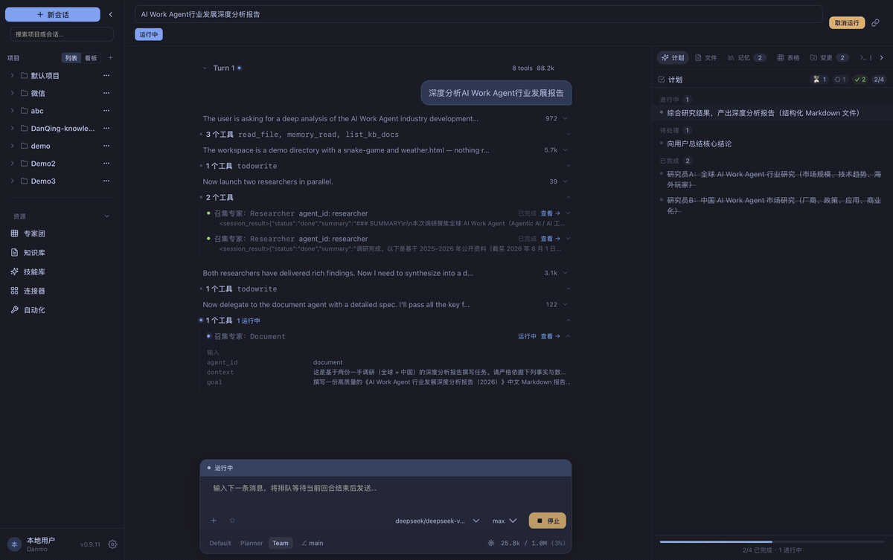

# Danmo Work

[English](README.md) | [中文](README.zh-CN.md)

[](https://github.com/danmo-ai/danmo-work/releases/latest)
[](LICENSE)
[](go.mod)
[](https://github.com/danmo-ai/danmo-work)

**Open-source AI work agent** — multi-agent, long-horizon work on your own machine. Coding, research, reports, slides, sheets, fiction, browser & desktop automation — one agent loop you can watch, correct, and resume. Self-hosted, MIT.

- **The model orchestrates.** No workflow graphs to configure. Subagents (`delegate_agent`), questions (`ask_user`), and MCP connectors are all just tools the agent calls as it plans.
- **Turn Log is state.** Every tool call lands in SQLite (`history.db`). Recover from a crash, replay a turn, edit a tool result, or resume days later — JSONL is export-only.
- **Everywhere.** Web · Desktop (Tauri) · CLI · TUI · Feishu / QQ / WeChat / WeCom — one engine, tools always running on your machine.

[](docs/screenshots/carousel.html?lang=en)

[Interactive carousel (captions)](docs/screenshots/carousel.html?lang=en) · [Architecture tour](docs/demo/product-tour.html?lang=en) · [Office co-edit tour](docs/demo/office-coedit-tour.html?lang=en&tour=1)

> Code, reports, decks, sheets, novels, demos, automations — on one trail.

---

## Highlights

| | |
|--|--|
| **Multi-agent teams** | **Team** lead delegates built-in specialists — Document, Implementer, Researcher, Reviewer, Browser, Computer, UI Test, GitHub, Novel Writing… — each in an isolated sub-turn; main context stays lean |
| **Plan → Execute** | Plan mode publishes via `create_plan` / `update_plan` into the right-hand Plan panel; hit **Execute** to send the plan into Composer. Day-to-day checklists still use `todowrite` |
| **File Stage + AI Diff** | Docs, slides, sheets, code, web, media, and diff on one canvas — routed by `routeProjectFile`; local HTML opens through app preview; pre-turn snapshot → review hunks → keep / revert / accept |
| **Novel workbench** | Scrivener-style shelf: book → volume → unit queue, cast wall & relation graph, one primary CTA per stage. Setup → plan → write → review with craft KB, anti-AI gates, and multi-model turns |
| **Agent UI testing** | Builtin **UI Test** expert authors Markdown specs under `ui-tests/`, runs them with `browser_*` (a11y-first) or headed `computer` on the Linux **desktop** sandbox, and returns PASS/FAIL with evidence |
| **Humans in the loop** | `ask_user` with options and forms; approval gates before risky shell, desktop control, or external MCP — same flow in desktop and IM chats |
| **Memory, tables & knowledge** | `memory_*` across user / project / agent scopes; schema-free `table_*` rows in `store.db`; Markdown knowledge bases with chapter-level FTS |
| **Skills, plugins & connectors** | Skill / plugin market (official catalog, Tech Leads Club, ClawHub, ArtCraft office CLIs); ambient disk skills; MCP connectors bound per agent; Codex-style plugin `hooks.json` |
| **Real sandbox** | OS-level isolation (Seatbelt / Landlock / bwrap / WSL2) or Podman/Docker env; `cli` Alpine shell or `desktop` (Xvfb + Chromium CDP + noVNC) profile; network deny / domain allowlist; four permission modes |
| **Long-horizon sessions** | Turn log + stream events in `history.db`; compaction checkpoints; `RecoverRunning` after crashes; sessions can span days or weeks |
| **Automations & IM** | Cron schedules and webhooks; Feishu / QQ / WeChat / WeCom outbound — progress cards, questions, and approvals in-channel |
| **Your model, your data** | Anthropic-native + OpenAI-compatible with per-vendor **protocol dialects** (DeepSeek, GLM, Qwen, Kimi, Gemini, Grok, MiniMax, Ollama…). Everything under `~/.danmo-work/` |

---

## Design

Three ideas run through the whole system (full architecture: [docs/core-design.md](docs/core-design.md)):

1. **Everything is a tool.** Files, shell, browser, desktop, memory, tables, knowledge, subagents (`delegate_agent`), even humans (`ask_user`) share one interface. The model decides what to call and when.
2. **The model orchestrates.** No developer-written control flow: the lead agent plans, delegates, and checks in with you on its own. Code and long-running work are the same loop at different depths — there is no mode switch.
3. **Logs are state.** Each turn is an append-only trail in SQLite (`history.db`). Compaction checkpoints, crash recovery, and replay are built in — not bolted on.

### Experts & teams

The lead agent runs the session; specialists do focused work on demand, each in an isolated sub-turn (roster and usage: [docs/experts.md](docs/experts.md)):

| Agent | Role |
|-------|------|
| **Team** (lead) | Multi-agent by default; collaboration toggle |
| **Document** | Workplace writing: reports default to Markdown; slides/sheets via bound skills; message polish (Comms folded in) |
| **Implementer** | Code changes from specs (TDD / debugging skills); `edit_batch` for ordered same-file edits |
| **Explorer** | Read-only codebase exploration |
| **Researcher** | Deep research and retrieval |
| **Reviewer** | Code and artifact review |
| **Browser** | Sticky multi-step browser tabs (`browser_*` via CDP) |
| **Computer** | Desktop GUI control — windows, click, type, screenshot (approval-gated) |
| **UI Test** | Agent-driven Web UI testing: Markdown specs executed via `browser_*` / `computer` on the Linux sandbox |
| **Data** | CSV / JSON analysis and reporting |
| **GitHub** | Issues, PRs, Actions, releases |
| **Danmo Make** | Local image / video / audio generation (separate app) |
| **Novel Writing** | Long-form fiction workbench: setup → plan → unit draft → review/commit; genre craft KB + quantitative anti-AI gates |
| **CodeGraph** (market) | Code intelligence — definitions, references, impact |
| **ArtCraft** (market) | Headless Word / Grid / Deck / Pdf craft CLIs as a plugin + MCP bundle |

Summon a specialist with `@` in the Composer, or just ask in plain language ("delegate the Document expert…"). Expert chips use **relay** mode — the lead forwards your goal verbatim. Without a chip, Team coordinates and splits work itself. The lead only sees the subagent's report, so the main context stays lean and KV-cache friendly. You can also build your own subagents in Teams, binding skills, tools, knowledge bases, and connectors.

Beyond experts, the same library hosts **skills** (workflows — document-writing, playable-slides, TDD, deep-research, writing-plans…) and **connectors** (MCP integrations). Install from the market (`kind: plugin` preferred), bind per agent, or drop skills into `~/.danmo-work/skills/` or `~/.agents/skills/`. Builtin specialists ship as plugins under `~/.danmo-work/plugins/` with optional `hooks.json` context injection.

### Plan mode

Flip **Plan** in the Composer to keep the turn read-only (plus `create_plan` / `update_plan`). The model publishes markdown + todos into the right-hand **Plan** panel; **Execute** exits plan mode and prefills the Composer so implementation starts from an agreed plan — not a chat dump that gets lost.

### File Stage

Three panes — projects · agent stream · right panel (Plan / Files / Memory / Table Store / Git / Terminal / Trajectory) — around a central **File Stage** routed by `routeProjectFile`: `.md` / `.csv` use built-in editors; `.udoc.json` / `.uslides.json` / `.usheet.json` are editable Univer IR; `.docx` / `.pptx` / `.xlsx` are view-only until converted to IR; source code opens in CodeMirror; HTML / images open as **web** / **media** (local pages go through app preview routes). On a web page you can click a DOM element, annotate it, and send exact HTML/CSS context to the Composer.

Office files are co-edited as a normal agent turn with a review step:

1. **Intent** — select text, a slide, or cells, type an instruction → `[office-edit]`
2. **Propose** — the agent edits; a snapshot is taken before the turn
3. **Review** — view the diff; keep, revert, or accept individual hunks
4. **Commit** — keep persists, revert restores the snapshot; the trail stays in the Turn Log

### Novel workbench

Open **Workbench** in the session chrome (or type `/novel`). Same three-pane layout as Office, purpose-built for long fiction:

- **Left** — book → volume → unit queue (status · unit id · chapter span · one-line function)
- **Center** — volume index / unit outline card / draft / **cast wall** / zoomable **relation graph**
- **Right** — one primary CTA inferred from disk state + injection preview (genre craft / unit card / on-stage cast)
- **Bottom** — Composer spanning the width; write and finalize are separate turns so you can switch models

Pipeline: `novel-setup` → `novel-plan` (cast + outlines, human-approved volumes) → `novel-write` (unit outlines / drafts with packed CONTEXT) → `novel-review` (qc-pack → review → commit). Craft lives in `kb-novel-craft` (shared + eight genre articles, plus crime-human flavor when needed); machine gates keep continuity, word quotas, and anti-AI style checks honest.

### Agent UI testing

Ask Team to run Web UI tests (or `@` the **UI Test** expert). Specs live as Markdown under `ui-tests/specs/`; runs write `ui-tests/runs/<stamp>/report.md` with per-scenario PASS/FAIL. Prefer `browser_*` a11y refs; escalate to `computer` for headed layout/canvas on the Linux desktop sandbox (`runtime.sandbox.profile=desktop`). Not Playwright codegen, and not for native Windows apps — details in [docs/experts.md](docs/experts.md) and [docs/agent-desktop-sandbox.md](docs/agent-desktop-sandbox.md).

### Safety

- **Soft gate** — permission modes (`discuss` / `plan` / `interactive` / `auto`); risky commands, desktop control, and external MCP ask before running
- **Hard sandbox** — OS-level isolation or Podman/Docker container env (`cli` or `desktop` profile); network `deny`, open, or domain allowlist
- `auto_approve` never silently approves dangerous commands; approvals render inside IM chats too

### Channels, remote & automations

- **IM on the same loop** — Feishu, QQ, WeChat, and WeCom connect outbound to your own accounts; progress cards, questions, and approvals appear in-channel. Tools still run on your machine.
- **Remote Hub** — pair this PC with [danmo-hub](https://github.com/danmo-ai/danmo-hub) so remote clients can drive it, even behind NAT.
- **Automations** — cron and webhook triggers run sessions while you're away.

---

## Install

| Platform | Package |
|----------|---------|
| **macOS** (Apple Silicon) | Homebrew or `.dmg` |
| **Windows** | Setup `.exe` |
| **Linux** (x86_64) | AppImage / `.deb` |

All binaries: [GitHub Releases](https://github.com/danmo-ai/danmo-work/releases/latest).

### macOS

```bash
brew tap danmo-ai/tap
brew install --cask danmo-work
# upgrade: brew update && brew upgrade --cask danmo-work
```

Fallback: `brew tap danmo-ai/danmo-work https://github.com/danmo-ai/danmo-work.git`  
Or download `Danmo.Work_*_arm64.dmg` from Releases. Not Apple-notarized yet — first launch: right-click → **Open**.

### Windows / Linux

- **Windows:** `Danmo.Work_*_x64-setup.exe` — until Authenticode is enabled, SmartScreen may warn → **More info → Run anyway**.
- **Linux:** `chmod +x Danmo.Work_*_amd64.AppImage && ./…` or `sudo apt install ./Danmo.Work_*_amd64.deb` (needs WebKitGTK).

### First run

Open the app, add an LLM API key in the UI (or `~/.danmo-work/config.yaml`), and pick a model. Projects, sessions, and memories land under `~/.danmo-work/` (`work.db` control plane, `history.db` turn log, `store.db` table store).

### From source

Needs sibling [`dq-ui`](https://github.com/danmo-ai/dq-ui). Then:

```bash
make dev-web   # backend :7801 + Vite :5801 → http://localhost:5801/app/
```

---

## Development

**Prerequisites:** Go 1.26+, Node.js 20+, sibling [`dq-ui`](https://github.com/danmo-ai/dq-ui).

```bash
make dev-web          # backend :7801 + Vite :5801 → http://localhost:5801/app/
make stop             # stop all DQ_DEV processes
make test-frontend    # frontend UI helper scripts (Plan / experts / File Stage / …)
mkdir -p ~/.danmo-work && cp config.example.yaml ~/.danmo-work/config.yaml
```

Build, pack, test, env vars, and CI: [`AGENTS.md`](AGENTS.md). Architecture: [`docs/core-design.md`](docs/core-design.md).

---

## Docs

| Doc | Description |
|-----|-------------|
| [docs/core-design.md](docs/core-design.md) | Agent architecture, tool system, channels, File Stage |
| [docs/experts.md](docs/experts.md) | Expert usage, builtin roster, novel workbench, UI Test |
| [docs/agent-desktop-sandbox.md](docs/agent-desktop-sandbox.md) | Desktop sandbox profile (Chromium CDP + computer + noVNC) |
| [docs/remote/README.md](docs/remote/README.md) | Remote Hub pairing and tunnel protocol |
| [docs/screenshots/README.md](docs/screenshots/README.md) | Screenshot carousel (README hero) |
| [docs/demo/README.md](docs/demo/README.md) | Architecture tour HTML / GIF / MP4 |
| [evals/dq_harbor/README.md](evals/dq_harbor/README.md) | Terminal-Bench 2.0 eval harness |
| [AGENTS.md](AGENTS.md) | Contributor quick reference |
| [config.example.yaml](config.example.yaml) | Full config reference |

## License

[MIT](LICENSE)
